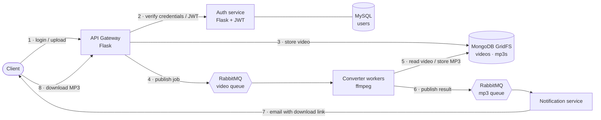

<div align="center">
  
  <h1>Video to MP3 Converter</h1>
  <p>An event-driven microservices system: upload a video, get an email when the MP3 is ready.<br>
  Python · Flask · RabbitMQ · MongoDB GridFS · MySQL · Docker · Kubernetes</p>
</div>

## Overview

A user logs in and uploads a video through an API gateway. The upload is stored and a conversion job is placed on a queue. A pool of converter workers extracts the audio with ffmpeg, and a notification service emails the user a download link. Each step is its own service, so each can scale and fail independently. If the converters are busy, uploads simply wait in the queue instead of timing out.

## Architecture



| Service | Responsibility | Key details |
| --- | --- | --- |
| **auth** (`src/auth`) | Verifies email and password, issues and validates JWTs | Passwords stored as salted hashes; parameterised SQL; tokens expire after 24h |
| **gateway** (`src/gateway`) | The only public entry point: `/login`, `/upload`, `/download` | Validates every request with the auth service; users can only download their own files |
| **converter** (`src/converter`) | Consumes the `video` queue and converts with ffmpeg | `prefetch_count=1` so work spreads evenly across replicas; failed jobs are rejected rather than retried forever |
| **notification** (`src/notification`) | Consumes the `mp3` queue and emails the user | Retries on transient SMTP errors |
| **rabbit** (`src/rabbit`) | RabbitMQ StatefulSet | Durable queues and persistent messages survive broker restarts |

**Reliability choices**

- **At-least-once processing.** Messages are acknowledged only after the work succeeds, so a worker crash mid-conversion returns the job to the queue.
- **No orphaned files.** If a job can't be published, the file just stored for it is deleted (in both the gateway and the converter).
- **Horizontal scaling.** Converters are stateless queue consumers. Raise `replicas` to convert more videos in parallel.

## API

| Method | Route | Auth | Result |
| --- | --- | --- | --- |
| POST | `/login` | HTTP Basic (email + password) | JWT |
| POST | `/upload` | `Authorization: Bearer <JWT>` + one multipart file | `202` with the stored video id; conversion queued |
| GET | `/download?fid=<mp3 id>` | `Authorization: Bearer <JWT>` | The MP3 (owner or admin only) |

```sh
TOKEN=$(curl -s -X POST -u you@example.com http://localhost:8080/login)
curl -X POST -F "file=@clip.mp4" -H "Authorization: Bearer $TOKEN" http://localhost:8080/upload
# ...the email contains the MP3 id
curl -o clip.mp3 -H "Authorization: Bearer $TOKEN" "http://localhost:8080/download?fid=<mp3 id>"
```

## Run it locally (Docker Compose)

```sh
docker compose up --build
docker compose exec auth python create_user.py you@example.com   # prompts for a password
```

- Gateway: http://localhost:8080
- RabbitMQ dashboard: http://localhost:15672 (guest / guest)
- Mailpit, which catches the notification emails: http://localhost:8025

## Deploy to Kubernetes (minikube)

MySQL and MongoDB run outside the cluster and are reached at `host.minikube.internal`.

```sh
minikube start && minikube addons enable ingress

# For each service: build and push the image, create its secret, then apply its manifests
docker build -t <your-dockerhub-user>/auth src/auth && docker push <your-dockerhub-user>/auth
cp src/auth/manifests/secret.example.yaml src/auth/manifests/secret.yaml   # fill in values
kubectl apply -f src/auth/manifests/
# ...repeat for gateway, converter and notification

kubectl apply -f src/rabbit/manifests/
```

Point `mp3converter.com` at `minikube ip` in `/etc/hosts` to reach the ingress. Replace `carltonosinde/*` in the deployment files with your own image names.

## Tests

Each service has its own unit tests, run in CI on every push:

```sh
cd src/<service> && pip install -r requirements.txt && python -m unittest discover -s tests -v
```

The converter tests run a real ffmpeg conversion on a generated clip.

## Project structure

```
src/
  auth/           Flask auth service, schema (init.sql), create_user.py, manifests
  gateway/        Flask API gateway, auth client, GridFS + queue publishing, manifests
  converter/      queue consumer + ffmpeg conversion, manifests
  notification/   queue consumer + SMTP email, manifests
  rabbit/         RabbitMQ StatefulSet and Service
docker-compose.yml
```

## Contact

Carlton Osinde Makini · [LinkedIn](https://www.linkedin.com/in/carltonosinde/) · [carltonosinde.com](https://carltonosinde.com) · [Email](mailto:carltonosinde@gmail.com)
